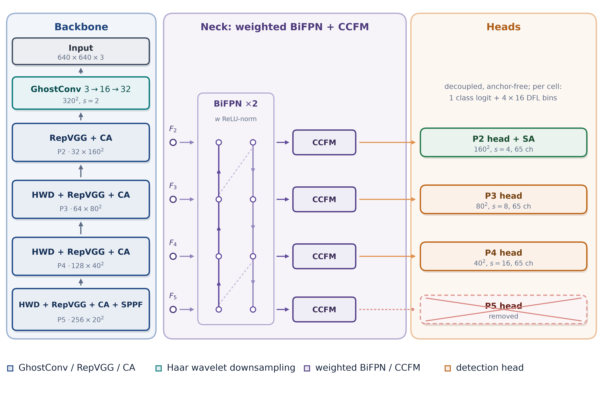

# BiFusion-YOLO

A lightweight, P2-enhanced YOLO26 detector with bidirectional multi-scale fusion
for ultra-small UAV detection.



BiFusion-YOLO targets the regime where a long-range quadcopter covers fewer than
20 x 20 pixels. It keeps a stride-4 prediction path, preserves high-frequency
detail through Haar wavelet downsampling, and fuses four pyramid levels with a
weighted BiFPN followed by cross-scale feature fusion (CCFM). The redundant
stride-32 head is removed, and the saved parameters are spent on the P2 branch.

The manuscript is available at
[paper/BiFusion-YOLO_Manuscript.pdf](paper/BiFusion-YOLO_Manuscript.pdf).

## Results

Reported on the DUT Anti-UAV detection test split at 640 x 640 input.

| Model | Params (M) | GFLOPs | P (%) | R (%) | mAP@0.5 (%) | mAP@0.5:0.95 (%) |
|---|---|---|---|---|---|---|
| YOLO26n | 2.58 | 8.2 | 92.9 | 85.3 | 91.1 | 60.8 |
| **BiFusion-YOLO** | **1.78** | **7.4** | **97.2** | **90.3** | **95.6** | **66.4** |

Gains over YOLO26n are +4.3, +5.0, +4.5 and +5.6 percentage points, with 30.9%
fewer parameters and 9.8% fewer FLOPs. Throughput is 89 FPS in TensorRT FP32 on
an RTX 3090 and 34 FPS in FP16 on a Jetson Orin 8 GB (15 W mode).

The gain is concentrated on the smallest targets:

| Width bin | Instances | YOLO26n mAP@0.5:0.95 | BiFusion-YOLO | Delta |
|---|---|---|---|---|
| < 10 px | 2,427 | 38.5 | 54.1 | +15.6 |
| 10-20 px | 3,140 | 53.2 | 63.5 | +10.3 |
| 20-32 px | 1,921 | 65.0 | 69.7 | +4.7 |
| 32-64 px | 1,566 | 85.0 | 78.5 | -6.5 |
| 64-96 px | 617 | 90.5 | 79.5 | -11.0 |
| > 96 px | 438 | 91.5 | 78.5 | -13.0 |

Objects wider than 32 pixels lose 6.5 to 13.0 points because there is no
stride-32 head. This trade-off is stated in the paper and is not hidden here.
All numbers are the values reported in the manuscript. They are not recomputed
by this repository, which does not ship the training logs or checkpoints.

More tables are in [docs/RESULTS.md](docs/RESULTS.md) and the machine-readable
copies are in `assets/results/`.

## Architecture

| Stage | Module | Output |
|---|---|---|
| Stem | GhostConv 3 to 16, GhostConv 16 to 32, stride 2 each | 32 x 160 x 160 |
| P2 | RepVGG, Coordinate Attention | 32 x 160 x 160 |
| P3 | HWD 32 to 64, RepVGG, Coordinate Attention | 64 x 80 x 80 |
| P4 | HWD 64 to 128, RepVGG, Coordinate Attention | 128 x 40 x 40 |
| P5 | HWD 128 to 256, RepVGG, Coordinate Attention, SPPF | 256 x 20 x 20 |
| Neck | 1x1 lateral adapters to 64, two 7-node weighted BiFPN blocks, four CCFM units | 32 / 64 / 128 / 256 |
| Heads | P2 head with spatial attention, P3 and P4 decoupled anchor-free heads | 65 channels per cell |

The four CCFM units share one 64 to 256 output projection and each level keeps
the prefix its head consumes. This is what makes the CCFM row of Table 3
(52,480 parameters) exact; see [docs/ARCHITECTURE.md](docs/ARCHITECTURE.md).

The deployed model matches Table 3: **1,783,110** convolution parameters and
biases. The 34 scalar fusion weights of the BiFPN are learnable parameters too,
so the all-parameter total is 1,783,144. `tools/count_params.py` prints both
numbers, the training count (batch normalization and RepVGG branches included)
and the two deployed conventions, and fails if the Table 3 total is wrong.

## Repository layout

```
bifusion/
  modules.py      GhostConv, RepVGG, Coordinate Attention, HWD, SPPF
  neck.py         lateral adapters, weighted BiFPN, CCFM
  head.py         spatial attention, decoupled head
  model.py        BiFusionYOLO, deployment, parameter report
  ops.py          anchors, box conversion, NMS, decoding
  loss.py         task-aligned assignment, CIoU, DFL
  data.py         DUT dataset, letterbox, mosaic, HSV, affine, copy-paste
  metrics.py      P/R/F1 at max-F1, AP, width-stratified AP
  train.py        training loop
  val.py          validation and test evaluation
  export.py       ONNX export and TensorRT build command
configs/
  bifusion_yolo.yaml
  dut.yaml
tools/
  count_params.py
  param_budget.py
tests/
  test_model.py
  test_modules.py
  test_loss.py
assets/
  figures/        figures from the manuscript
  results/        tables from the manuscript as CSV and JSON
paper/
  BiFusion-YOLO_Manuscript.pdf
docs/
  ARCHITECTURE.md
  TRAINING.md
  RESULTS.md
  REPRODUCIBILITY.md
```

## Install

Python 3.9 or newer is required.

```bash
python -m venv .venv
.venv\Scripts\activate
pip install -r requirements.txt
pip install -e .
```

On Linux or macOS the activation line is `source .venv/bin/activate`.

## Data

Download the DUT Anti-UAV detection split and arrange it in YOLO format:

```
datasets/DUT/
  images/train/  labels/train/
  images/val/    labels/val/
  images/test/   labels/test/
```

Each label line is `class x_center y_center width height`, normalized to the
image size. The single UAV class is index 0. The expected counts are 5,200,
2,600 and 2,200 images for train, validation and test.

## Training

```bash
python -m bifusion.train \
  --config configs/bifusion_yolo.yaml \
  --data configs/dut.yaml \
  --device 0
```

The recipe is the one in Table 5: 300 epochs, batch 16, AdamW with a cosine
schedule, three warm-up epochs, EMA 0.9999, mixed precision, mosaic disabled
for the last ten epochs, and loss weights 7.5 / 0.5 / 1.5. Runs are written to
`runs/train/bifusion_yolo/` with `best.pt`, `last.pt` and `results.csv`.

## Evaluation

```bash
python -m bifusion.val \
  --checkpoint runs/train/bifusion_yolo/best.pt \
  --data configs/dut.yaml \
  --split test \
  --device 0
```

The evaluator reports precision, recall and F1 at the confidence that maximises
F1 on the evaluated split, plus mAP@0.5, mAP@0.5:0.95 and AP for the six width
bins. Add `--deploy` to evaluate the fused model.

## Export

```bash
python -m bifusion.export \
  --checkpoint runs/train/bifusion_yolo/best.pt \
  --output bifusion_yolo.onnx \
  --format engine \
  --fp16
```

This writes the ONNX graph and prints the `trtexec` command for the TensorRT
engine. The export path fuses batch normalization and the RepVGG branches
first, so the engine matches the deployed parameter count.

## Tests

```bash
pytest -q
```

The tests build the model, check every module against its row in Table 3, run a
forward pass, and run the loss on a random batch.

## Reproducibility

The protocol used in the paper is documented in
[docs/REPRODUCIBILITY.md](docs/REPRODUCIBILITY.md). The short version:

- single DUT training split, validation for model selection, test touched once;
- the same augmentation, epoch budget and evaluation script for every retrained
  detector;
- AP with the 101-point COCO interpolation and a maximum of 300 detections;
- NMS IoU 0.70 and AP confidence 0.001, with the reported P/R/F1 at the
  max-F1 confidence;
- ten seeds for the significance tests in the paper.

This repository contains the code, not the trained weights or the training
logs. The reported values are the ones in the manuscript; run the recipe above
to reproduce them on your own copy of the data.

## What is in this release

Included: model code, training and evaluation code, export path, configuration
files, unit tests, the manuscript PDF, the figures used in the paper, and the
paper tables as CSV and JSON.

Not included: the DUT images (download from the original authors), trained
weights, TensorRT engines, and the per-run logs. Those are not needed to read
the code, and they keep the repository small.

## Citation

```bibtex
@article{ali2026bifusion,
  title   = {BiFusion-YOLO: A Lightweight P2-Enhanced YOLO26 with Bidirectional
             Multi-Scale Fusion for Ultra-Small UAV Detection},
  author  = {Ali, Mohamed and Safan, Mahmoud M. and Ayyad, Sarah M.},
  journal = {Manuscript},
  year    = {2026}
}
```

## License

The code license will be finalized before public release. Until then, all
rights are reserved by the authors; see [LICENSE](LICENSE). The manuscript text
and the figures remain the copyright of their authors.

## Acknowledgements

The DUT Anti-UAV, Anti-UAV, Drone-vs-Bird and Det-Fly datasets are public and
were collected for research. The baseline follows the official YOLO26
implementation from Ultralytics.
