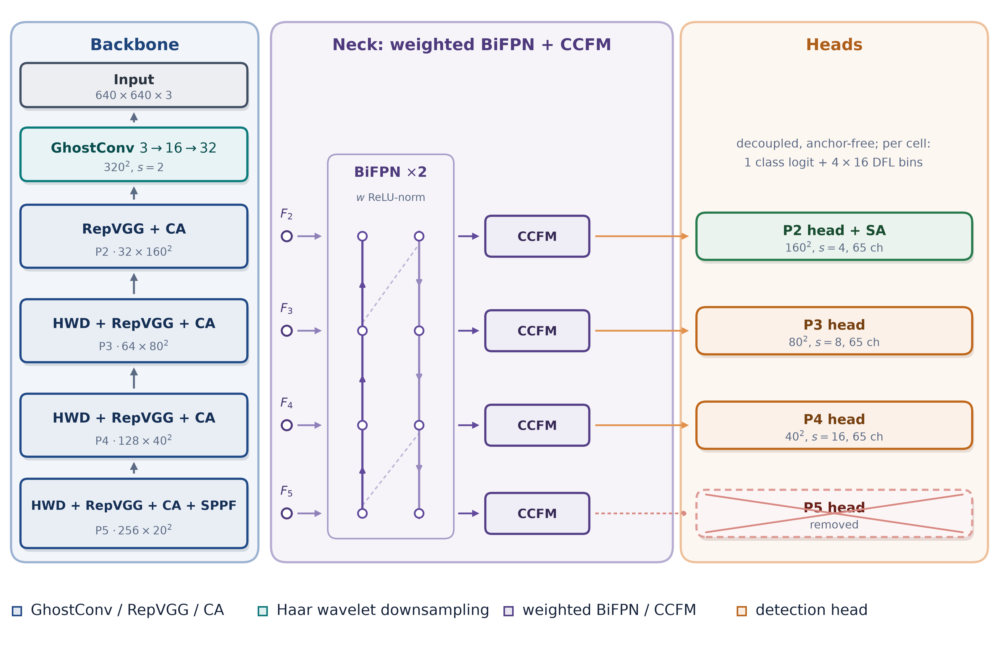

# Architecture

The detector follows the layer order of Table 3 in the manuscript. All tensors
are `C x H x W`, and the input is `3 x 640 x 640` RGB.



## Layer table

| # | Module | Input | Output | Kernel | Stride | Params |
|---|---|---|---|---|---|---|
| 0 | Input | 3 x 640 x 640 | 3 x 640 x 640 | - | - | - |
| 1 | GhostConv | 3 x 640 x 640 | 16 x 320 x 320 | 3x3 | 2 | 304 |
| 2 | GhostConv | 16 x 320 x 320 | 32 x 160 x 160 | 3x3 | 2 | 2,480 |
| 3 | RepVGG | 32 x 160 x 160 | 32 x 160 x 160 | 3x3 | 1 | 9,248 |
| 4 | Coordinate Attention | 32 x 160 x 160 | 32 x 160 x 160 | - | - | 1,096 |
| 5 | HWD | 32 x 160 x 160 | 64 x 80 x 80 | 1x1 | 2 | 8,256 |
| 6 | RepVGG | 64 x 80 x 80 | 64 x 80 x 80 | 3x3 | 1 | 36,928 |
| 7 | Coordinate Attention | 64 x 80 x 80 | 64 x 80 x 80 | - | - | 2,184 |
| 8 | HWD | 64 x 80 x 80 | 128 x 40 x 40 | 1x1 | 2 | 32,896 |
| 9 | RepVGG | 128 x 40 x 40 | 128 x 40 x 40 | 3x3 | 1 | 147,584 |
| 10 | Coordinate Attention | 128 x 40 x 40 | 128 x 40 x 40 | - | - | 4,360 |
| 11 | HWD | 128 x 40 x 40 | 256 x 20 x 20 | 1x1 | 2 | 131,328 |
| 12 | RepVGG | 256 x 20 x 20 | 256 x 20 x 20 | 3x3 | 1 | 590,080 |
| 13 | Coordinate Attention | 256 x 20 x 20 | 256 x 20 x 20 | - | - | 8,712 |
| 14 | SPPF | 256 x 20 x 20 | 256 x 20 x 20 | 5x5 | 1 | 164,224 |
| 15 | Lateral 1x1 adapters | F2 to F5 | 64 channels | 1x1 | 1 | 30,976 |
| 16 | Weighted BiFPN x2 | 64 channels | 64 channels | 3x3 | 1 | 67,200 |
| 17 | CCFM x4 | 64 channels | 32 / 64 / 128 / 256 | 3x3 | 1 | 52,480 |
| 18 | P2 head + spatial attention | 32 x 160 x 160 | 160 x 160 x 65 | 3x3 | 1 | 115,172 |
| 19 | P3 head | 64 x 80 x 80 | 80 x 80 x 65 | 3x3 | 1 | 151,937 |
| 20 | P4 head | 128 x 40 x 40 | 40 x 40 x 65 | 3x3 | 1 | 225,665 |
| | **Total** | | | | | **1,783,110** |

The 65 output channels per cell are one class logit and `4 x 16` distribution
focal bins.

## Module details

### GhostConv

The primary convolution produces `m = cout / 2` channels. A depthwise `3x3`
operation produces the other `m`, and the two are concatenated. The stem uses
`cout = 16` and `32`, both with stride 2.

### RepVGG

Training keeps three branches: `3x3`, `1x1` and identity, each followed by its
own batch normalization. Deployment fuses all three into a single `3x3`
convolution with a bias, which is why the deployed count of a 32-channel block
is `9 * 32 * 32 + 32 = 9,248`.

### Coordinate Attention

Height and width descriptors are pooled separately, concatenated, projected by a
shared 1x1 convolution with `max(C/32, 8)` channels, split, and passed through
two 1x1 convolutions with sigmoid gates. The output is multiplied by the row and
column gates. At 32 channels the bottleneck is 8, so the module has
`64*8 + 8 + 8*32 + 32 + 8*32 + 32 = 1,096` deployed parameters.

### Haar wavelet downsampling

One level of the Haar transform produces LL, LH, HL and HH at half resolution.
The four are concatenated and fused by a 1x1 convolution, batch normalization
and SiLU. The deployed cost is `4 * cin * cout + cout`.

### SPPF

A 1x1 convolution reduces 256 to 128 channels, three max pools produce a
four-way concatenation of 512 channels, and a second 1x1 convolution returns to
256. The deployed cost is `256*128 + 128 + 512*256 + 256 = 164,224`.

### Weighted BiFPN

Each block has seven fused nodes: three top-down nodes (P4, P3, P2), one
bottom-up node at P2, and three three-input bottom-up nodes at P3, P4 and P5.
Each node computes a ReLU-normalized weighted sum followed by a depthwise 3x3
and a pointwise 1x1 convolution, which costs `9*64 + 64 + 64*64 + 64 = 4,800`.
Two blocks therefore cost `2 * 7 * 4,800 = 67,200`.

The fusion weights are nonnegative and divided by their sum plus `1e-4`, as in
Eqs. (28) and (29) of the paper. The implementation is `neck.FusionNode`.

### CCFM

Each unit projects the level and its neighbour to 64 channels with a shared 1x1
convolution, sums them, refines the sum with a depthwise separable block, adds
the projected level as a residual, and applies the output projection.

The four units share one `64 -> 256` output projection (`16,640` parameters),
and each level keeps the prefix its head consumes: 32 channels at P2, 64 at P3,
128 at P4 and 256 at P5. This is what makes the CCFM row exact:

```
4 * (4,160 + 4,800) + 16,640 = 52,480
```

Computing only the prefix a level needs keeps the arithmetic close to four
separate 64-channel projections while remaining a single parameter matrix.

### Detection heads

The P2 head applies a 7x7 spatial attention over the channel mean and maximum
(99 parameters), multiplies the feature, and passes it to two decoupled
branches. Each branch is two 3x3 convolutions followed by a 1x1 output. P3 and
P4 use the same head without the attention stage. P5 has no head.

## Parameter accounting

The counts are deployed counts: batch normalization is folded into the preceding
convolution, and each RepVGG block collapses to one 3x3 convolution. The
training model is larger because it keeps the three RepVGG branches and the
batch-normalization statistics.

```
backbone   1,139,680
neck         150,656
heads        492,774
total      1,783,110
```

The neck row counts the 4,160 and 4,800 convolution parameters of each CCFM
unit; it does not include the 34 scalar fusion weights of the BiFPN, which are
learnable parameters but are not itemized in Table 3. The all-parameter
deployed count is therefore 1,783,144, and both numbers are reported by
`tools/count_params.py`.

Run `python tools/param_budget.py` for the arithmetic without PyTorch, or
`python tools/count_params.py --check` to build the model and compare the
deployed count with Table 3.
